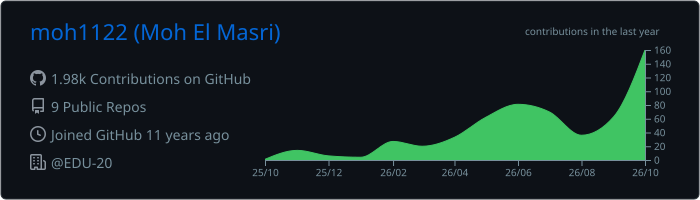
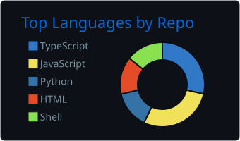
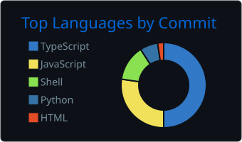
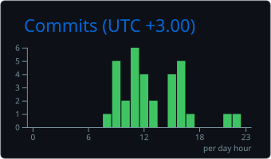
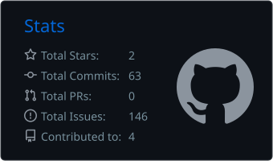

<div align="center">

# Hi, I'm Moh El Masri 👋

### Senior iOS Engineer & Indie App Creator

Native apps. Thoughtful architecture. From idea to App Store.

[](https://apps.apple.com/developer/mohammad-masri/id975614455)
[](https://github.com/moh1122?tab=followers)
[](https://github.com/moh1122?tab=repositories)

[Portfolio](https://iosapps.cloud) · [App Store](https://apps.apple.com/developer/mohammad-masri/id975614455) · [LinkedIn](https://www.linkedin.com/in/mohammadmasri-ios/) · [Email](mailto:mmasri@email.com)

</div>

---

## `> whoami`

```swift
struct Moh {
    let name = "Moh El Masri"
    let role = "Senior iOS Engineer & Indie App Creator"
    let stack = ["Swift", "SwiftUI", "UIKit"]
    let focus = ["Native apps", "Clean architecture", "Product delivery"]
    let interests = ["AI", "Automation", "Bitcoin"]
    let portfolio = "https://iosapps.cloud"
}
```

I build and maintain **35+ published iOS apps** across finance, utilities, and games. My work covers the full product lifecycle: architecture, development, testing, App Store releases, and ongoing improvements.

Alongside my app work, I'm a **Senior Solutions Engineer at CYPHER Learning**, working on enterprise learning platforms, technical discovery, solution architecture, API integrations, and implementation planning.

---

## ⚡ Tech Stack

<div align="center">


</div>

| Area | Technologies & practices |
| --- | --- |
| **Native iOS** | Swift · SwiftUI · UIKit · async/await · Combine |
| **Architecture & data** | MVVM-C · Modular SPM · Dependency injection · SwiftData · Core Data · Offline-first experiences |
| **Apple ecosystem** | StoreKit 2 · WidgetKit · APNs · TestFlight |
| **Backend & integrations** | Firebase · Supabase · REST APIs · Authentication |
| **Delivery & tooling** | Fastlane · GitHub Actions · Unit & UI testing · Python automation |

---

## 🚀 Featured Apps & Projects

| App / Project | What it does | My work |
| --- | --- | --- |
| [**Bitcoin the Digital Gold**](https://apps.apple.com/us/app/bitcoin-the-digital-gold/id6739493210) | Bitcoin prices, portfolio tracking, widgets, and an Apple Watch experience. | Independent app |
| [**Biometric Notes**](https://apps.apple.com/us/app/biometric-notes/id991357855) | Private notes with biometric protection and encrypted storage. | Independent app |
| [**Conflict Radar**](https://apps.apple.com/us/app/conflict-radar/id6759931315) | Geopolitical news, market signals, maps, and AI briefs in one dashboard. | Independent app |
| [**PilotLink**](https://apps.apple.com/us/app/pilotlink/id6747921246) | An aviation community connecting pilots and industry professionals through discovery and messaging. | Selected development project |

**[Explore the full portfolio →](https://iosapps.cloud)**

---

## 🛠️ Developer Tools

| Project | Stars | Description |
| --- | --- | --- |
| [**App Store Connect Screenshot Reset**](https://github.com/moh1122/AppStore-Connect-ScreenShot-Reset) |  | A Python utility I created to inspect and remove screenshot sets stuck processing in App Store Connect. |

---

## 📊 GitHub Stats

<div align="center">






</div>

<sub>GitHub charts describe repository activity; the app portfolio above shows my published products.</sub>

---

## 🕐 When I Code · UTC+3

<div align="center">




</div>

---

## ⚡ Recent Public Activity

<!--START_SECTION:activity-->
- **2026-10-04** — Pushed updates to [moh1122/AppStore-Connect-ScreenShot-Reset](https://github.com/moh1122/AppStore-Connect-ScreenShot-Reset).
<!--END_SECTION:activity-->

---

## 🌐 Connect

<div align="center">

[](https://iosapps.cloud)
[](https://apps.apple.com/developer/mohammad-masri/id975614455)
[](https://www.linkedin.com/in/mohammadmasri-ios/)
[](https://medium.com/@moemasri86)
[](mailto:mmasri@email.com)

**Available for selected app development and technology consulting engagements.**

App development · Architecture & integration · Ongoing product collaborations

</div>
